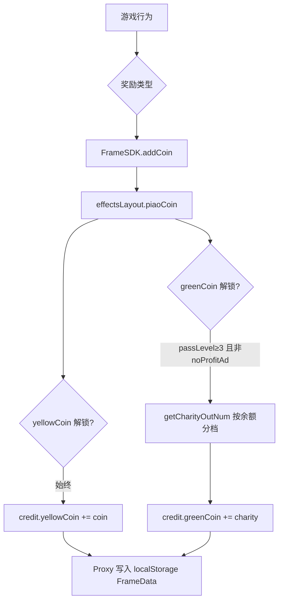
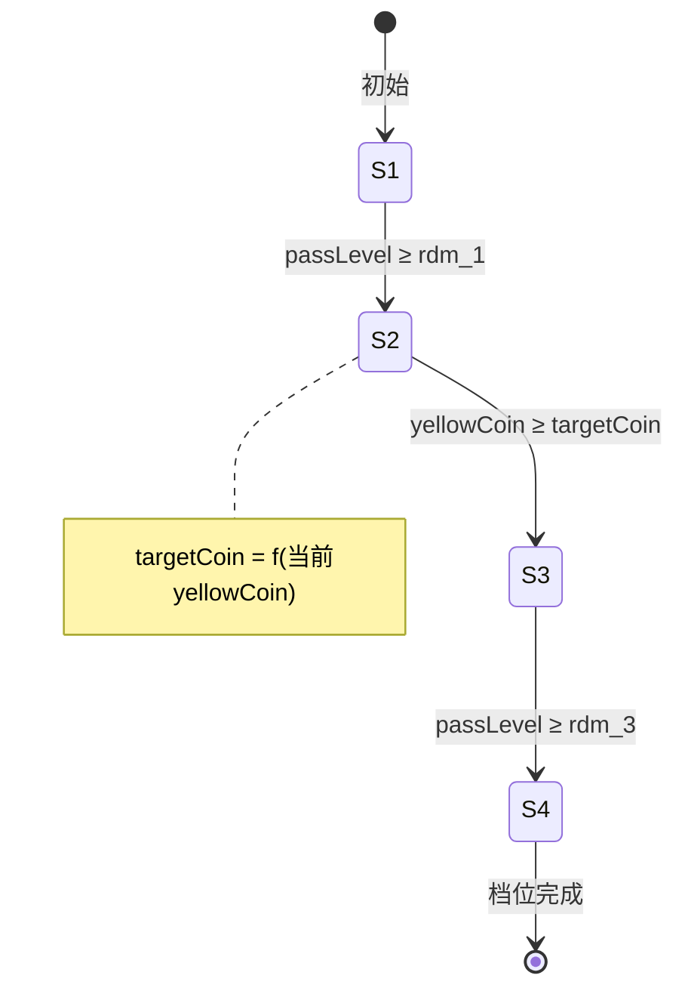
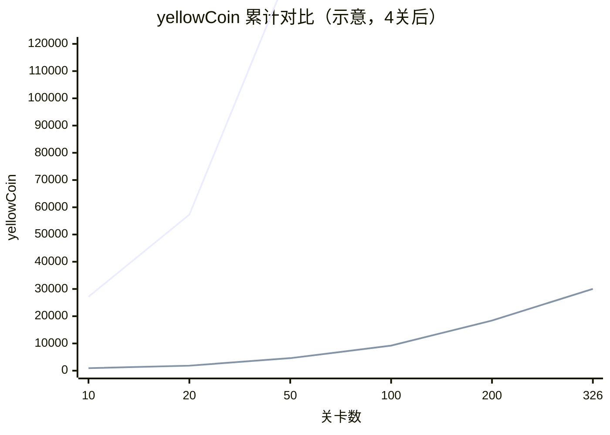
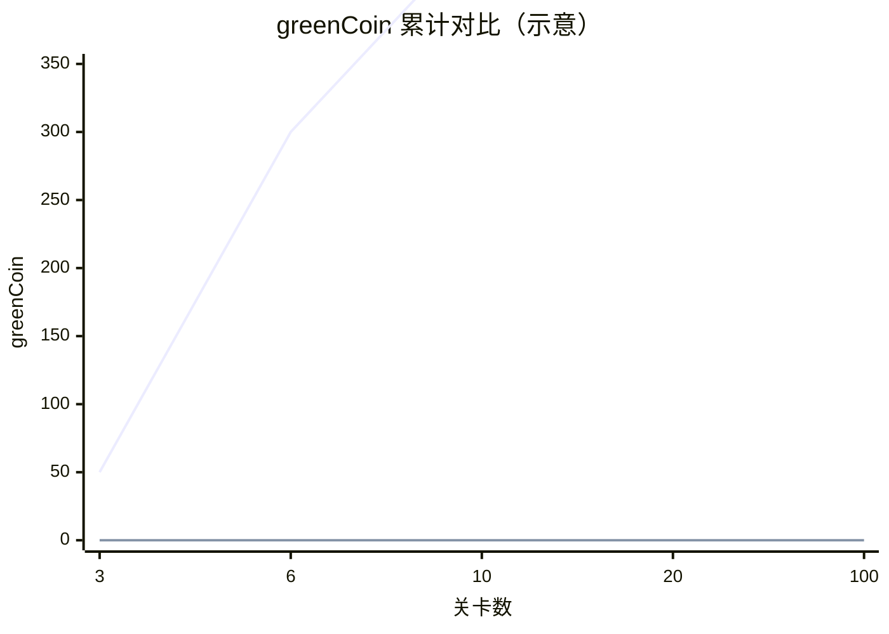

# FrameData 中 yellowCoin / greenCoin 增长与提现规则分析

> 分析来源：`assets/scripts/Frame/FrameData.ts`、`effectsLayout.ts`、`RDM_Level.ts`、`RDM_Charity.ts`、`FrameSDK.ts` 及相关奖励面板。  
> 分析日期：2026-10-17

---

## 1. localStorage 存储结构

### 1.1 存储键与格式

| 项目 | 说明 |
|------|------|
| **键名** | `"FrameData"` |
| **格式** | JSON 字符串 |
| **读写** | `FrameSaveData.setlocalStorageItem` / `getlocalStorageItem` |

```json
{
  "credit": {
    "yellowCoin": 0,
    "greenCoin": 0
  },
  "CoinStep": {},
  "CharityStep": {},
  "account": "",
  "...": "其他字段"
}
```

### 1.2 持久化时机

1. **Proxy 自动保存**：对 `FrameData.saveData` 任意字段赋值时，通过 Proxy 的 `set` 拦截器立即写回 localStorage。
2. **应用切后台**：监听 `cc.game.EVENT_HIDE`，再次全量写入。

### 1.3 字段含义

| 字段 | 含义 |
|------|------|
| `credit.yellowCoin` | 现金类代币（提现面板 RDM_Level 使用） |
| `credit.greenCoin` | 慈善类代币（提现面板 RDM_Charity 使用） |
| `CoinStep[rdm_id]` | 现金提现各档位进度 `{ status, targetCoin }` |
| `CharityStep[rdm_id]` | 慈善提现各档位进度 `{ status }` |
| `account` | 提现账户信息（为空时需先填 `Panel_Account`） |

---

## 2. 数值如何增长（核心入口）

所有增长最终汇聚到 `FrameSDK.addCoin(coin, charity, flag, done)`，触发 `ADD_COIN` 事件，由 `effectsLayout.piaoCoin` 写入：

```typescript
FrameData.saveData.credit.yellowCoin += coin;
FrameData.saveData.credit.greenCoin += charity;
```

### 2.1 yellowCoin 增长来源一览

| 来源 | 触发条件 | 单次增量 | 是否随余额变化 |
|------|----------|----------|----------------|
| 新手翻牌 `Panel_Award_New` | 首次引导 | `newFixed`: **[1000, 200, 100]**（三档展示，实际领取第 1 档 **1000**） | 否 |
| 清台奖励 A `Panel_Award_1` | 击球清台且 level ≥ 3 | 基础 **100** × 倍率 **7~10**（首次固定 10 倍）→ **700~1000**；免费领取 **20** | 否 |
| 清台奖励 B `Panel_Award_3` | 同上，A/B 交替 | 基础 **150** × 倍率 **2/3/5**（指针停位）→ **300~750**；免费领取 **20** | 否 |
| 过关宝箱 `Panel_Award_5` | 每关胜利 | 3 个宝箱各 **randomInt([30,80])**；全开后再看广告 **1000**，放弃广告 **50** | 否 |
| 飞行宝箱 `FlyingBonus` | passLevel ≥ 4，看广告 | **1000** | 否 |
| 关卡任务 `Panel_Task` | passLevel 达指定关卡 | **200 / 300 / 500 / 1000 / 1500 / 1500 / 2000 / 3000** | 否 |
| 存钱罐 `Panel_Activity` | passLevel ≥ 2，罐满 | **30000**（一次性） | 否 |
| 复活 `FuHuoPageCtrl` | 看广告复活 | **500**（`bonusForReviving`） | 否 |
| 道具页 `UsePropPageCtrl` | 看广告用道具 | **500**（购买道具奖励） | 否 |
| 超级奖励 `Panel_SuperReward` | 任务完成 | **5000~10000** 等 | 否 |
| Debug 面板 | 调试 | 任意 | — |

> **清台奖励触发**：`game_table.ts` 中 `level_a >= startLevelForClearAward(3)` 且己方击球全部结束后，调用 `openABAward`，在 `Panel_Award_1` 与 `Panel_Award_3` 间交替弹出。

### 2.2 greenCoin 增长来源

greenCoin **仅在非 noProfitAd 模式**下产生（`CashFishCredit.isUnlocked("greenCoin")` 且 `effectsLayout` 中 `hasGreen` 为 true）。

| 来源 | 触发条件 | 单次增量 |
|------|----------|----------|
| 各类激励视频成功 | 看广告领 yellowCoin 时附带 | `getCharityOutNum()`（见 §3.2） |
| 关卡开始前插屏/视频 | passLevel ≥ 9 且冷却结束 | 仅 greenCoin，`yellowCoin=0` |
| 解锁球杆 `NewCueListLitemCtr` | 看广告 | 仅 greenCoin |

greenCoin **解锁条件**（`CashFishCredit.isUnlocked`）：

- `!noProfitAd`
- `passLevel >= charityLevel`（默认 **3**）
- `charityGuideIndex > 0`（完成慈善引导）

---

## 3. 每次增加多少 — 详细配置

配置位于 `FrameData.FRAME_CONF.OutputConfig`（可被服务器 `initSettings` 覆盖）：

```javascript
OutputConfig: {
  newFixed: [1000, 200, 100],   // 新手三档
  new: 1000,
  ad: 100,                      // Panel_Award_1 基础
  adRate: [7, 10],              // 倍率范围；首次固定 adRate[1]=10
  adDisplayRate: [2, 10],       // UI 展示倍率范围
  draw: 150,                    // Panel_Award_3 基础
  drawRate: [2, 3, 5],          // 转盘倍率
  free: 20,                     // 各面板"免费领取"按钮
  superFree: 50,                // 超级奖励放弃广告
  superAd: 1000,                // 过关宝箱看广告
  boxRandom: [30, 80],          // 过关宝箱每个盒子
  flyingBonus: 1000,            // 飞行宝箱
  charity: 1,                   // 慈善进度估算除数（UI 提示用）
  charityRate: [5, 10],         // 每得 1 greenCoin 额外增加 charityDonated
  charityPerPeople: 10
}
```

### 3.1 yellowCoin：增量与总余额无关

代码中 **没有任何** 根据 `credit.yellowCoin` 当前值缩减增量的逻辑。  
每次 `getCoinOutNum(key)` 直接返回配置常量（或固定随机范围）。

**典型单次增量汇总（profit 模式，看广告）：**

| 场景 | 最小 | 最大 | 期望约 |
|------|------|------|--------|
| 清台 A（首次） | 100×10=1000 | 100×10=1000 | 1000 |
| 清台 A（常规） | 100×7=700 | 100×10=1000 | 850 |
| 清台 B | 150×2=300 | 150×5=750 | 450~550 |
| 过关 3 盒 + 广告 | 90+1000=1090 | 240+1000=1240 | ~1165 |
| 过关 3 盒 + 放弃广告 | 90+50=140 | 240+50=290 | ~215 |
| 飞行宝箱 | 1000 | 1000 | 1000 |

### 3.2 greenCoin：增量随总余额递减（核心机制）

`FrameData.getCharityOutNum()` 根据 **当前 greenCoin 余额** 查表 `charityOutput`：

| 档位 id | 已有 greenCoin 区间 | 每次随机增量 value |
|---------|---------------------|---------------------|
| 101 | [0, 100) | **[50, 50]** 固定 50 |
| 102 | [100, 150) | **[20, 25]** |
| 103 | [150, 200) | **[10, 20]** |
| 104 | [200, 250) | **[5, 10]** |
| 105 | [250, 275) | **[3, 5]** |
| 106 | [275, 290) | **[1, 2]** |
| 107 | [290, 300) | **[1, 1]** 固定 1 |
| 107+ | ≥ 300 | 沿用最后一档 **[1, 1]** |

**结论：greenCoin 单次增量会随余额增大而显著减少；yellowCoin 不会。**

---

## 4. 能否绘制「增长次数 vs 总数值」曲线

**可以。** 两类曲线特征不同：

### 4.1 yellowCoin — 阶梯/线性叠加（取决于玩家行为）

若假设玩家每次固定获得 `avg_y`（如清台看广告 850），则：

```
total_yellow(n) = initial + n × avg_y
```

曲线为 **直线**（斜率 = 单次均值）。若混合多种来源，可对每次事件加权求和，仍为分段线性。

### 4.2 greenCoin — 分段递减斜率

按 `charityOutput` 档位模拟，每看一次广告 +1 次增长：

```python
# 模拟脚本（Python）
def simulate_green_coin(ads_per_tier_avg=5):
    tiers = [
        (0,   100, 50, 50),
        (100, 150, 20, 25),
        (150, 200, 10, 20),
        (200, 250, 5,  10),
        (250, 275, 3,  5),
        (275, 290, 1,  2),
        (290, 300, 1,  1),
    ]
    balance = 0
    history = [(0, 0)]  # (增长次数, 总greenCoin)
    count = 0
    for lo, hi, vmin, vmax in tiers:
        avg = (vmin + vmax) / 2
        while balance < hi and balance < 300:
            gain = avg  # 或用 random
            balance += gain
            count += 1
            history.append((count, round(balance, 1)))
            if balance >= 300:
                break
    return history

# 示例输出（每档取区间均值、档内循环至上限）：
# 0→100: 约2次(×50)
# 100→150: 约2~3次(×22.5)
# ...
# 总计约 300 greenCoin 需 ~15~25 次广告（视随机与是否每局都看广告）
```

**曲线形态**：开始陡峭（每次 +50），接近 300 后几乎平坦（每次 +1）。  
适合用折线图：`X=累计获得次数, Y=greenCoin 余额`。

### 4.3 建议采集方式（真实玩家数据）

在 DevTools 中监听 `FRESH_CREDIT` 事件，或定时读取：

```javascript
JSON.parse(localStorage.getItem("FrameData")).credit
```

记录每次 `(timestamp, yellowCoin, greenCoin, change)` 即可绘制双轴曲线。

---

## 5. 提现规则与条件

游戏内提现分两套 UI：

- **现金提现** → 点击 yellowCoin 图标 → `RDM_Level`（Panel_Yellow）
- **慈善提现** → 点击 greenCoin 图标 → `RDM_Charity`（Panel_Charity）

> 注意：此为客户端进度/展示逻辑；实际打款若存在需结合服务端接口（见 `AA_SdkConfigs/服务器相关接口.txt`）。代码中完成最后一步 **不扣减** yellowCoin/greenCoin 余额。

### 5.1 配置两套模式

`FrameSDK.correctConfigs()` 在 **`!noProfitAd`（profit 模式）** 时覆盖默认值：

| 配置项 | 默认（noProfitAd） | profit 模式覆盖 |
|--------|-------------------|-----------------|
| `CoinConf[0].rdm_1` | 50 关 | **20 关** |
| `CoinConf[1].rdm_1` | 100 关 | **40 关** |
| `CoinConf[*].rdm_3` | 200 关 | **100 关** |
| `RedeemRateConfig[0]` | 1000 | **10** |

以下 **profit 模式** 为主（正常变现用户），并附默认模式对照。

### 5.2 yellowCoin 提现（RDM_Level）— 三阶段状态机

每个 `CoinConf` 档位（2 档）独立推进 `CoinStep[rdm_id].status`：

```
Status 1 ──(过关≥rdm_1)──► Status 2 ──(yellowCoin≥targetCoin)──► Status 3 ──(过关≥rdm_3)──► Status 4(完成)
```

| Status | 条件 | profit 模式 | 默认模式 |
|--------|------|-------------|----------|
| **1 → 2** | 通关关卡 ≥ `rdm_1` | 档位1: **20关**；档位2: **40关** | 50 / 100 关 |
| **2 → 3** | `yellowCoin ≥ targetCoin` | 动态计算（见下） | 同公式 |
| **3 → 4** | 通关关卡 ≥ `rdm_3` | **100 关** | 200 关 |

**动态 targetCoin 公式**（进入 Status 2 时，按 **当时** yellowCoin 计算并固化）：

```
step = RedeemRateConfig[0] × RedeemTargetConfig.factor
     = RedeemRateConfig[0] × 100

targetCoin = ceil(currentYellowCoin / step) × RedeemTargetConfig.ratio × step + RedeemTargetConfig.extra
           = ceil(currentYellowCoin / step) × 2 × step + 30000
```

**profit 模式**（step = 10 × 100 = **1000**）示例：

| 进入 Status2 时 yellowCoin | targetCoin | 还需凑够 | 约合显示金额* |
|---------------------------|------------|----------|---------------|
| 0 | 30,000 | 30,000 | $3,000 |
| 5,000 | 40,000 | 35,000 | $4,000 |
| 10,000 | 50,000 | 40,000 | $5,000 |
| 20,000 | 70,000 | 50,000 | $7,000 |

\* 显示金额 = `yellowCoin / RedeemRateConfig[0]` × 国家汇率（美国 rate=1）。

**默认模式**（step = 1000 × 100 = **100,000**）示例：

| 进入 Status2 时 yellowCoin | targetCoin |
|---------------------------|------------|
| 0 | 30,000 |
| 50,000 | 230,000 |
| 100,000 | 230,000 |
| 150,000 | 430,000 |

**提现操作前置**：

1. 当前阶段 `now >= total`（进度满）
2. 若 `account` 为空 → 弹出 `Panel_Account` 填写账户
3. 点击确认 → 推进 status，**不扣除 yellowCoin**

**Status 5（排队）**：若 `QueueUp[id]` 存在则显示排队状态（模拟排队人数动画，非真实队列 API）。

### 5.3 greenCoin 提现（RDM_Charity）— 两阶段

`CharityConf` 两档：

| 档位 | Status 1 条件 (greenCoin) | Status 2 条件 (关卡) | 展示奖励 reward |
|------|--------------------------|----------------------|-----------------|
| rdm_id=1 | **≥ 300** | **≥ 100 关** | 2,000（显示单位） |
| rdm_id=2 | **≥ 500** | **≥ 100 关** | 5,000（显示单位） |

```
Status 1 ──(greenCoin≥rdm_1)──► Status 2 ──(passLevel≥rdm_2)──► Status 3(完成)
```

**完整提现一档 charity 的最低要求（profit 模式）**：

| 代币 | 数量 | 关卡 |
|------|------|------|
| greenCoin | **300** | — |
| passLevel | — | **100** |

第二档：greenCoin **500** + **100 关**。

**greenCoin 解锁**：passLevel ≥ **3** 且完成慈善引导。

### 5.4 提现规则小结表（profit 模式，美国）

| 提现类型 | 档位 | 所需 greenCoin | 所需 yellowCoin | 所需关卡 | 其他 |
|----------|------|----------------|-----------------|----------|------|
| 现金 1 | CoinConf[0] | — | 动态 targetCoin（≥30,000 起） | 20 → 100 | 填账户 |
| 现金 2 | CoinConf[1] | — | 动态 targetCoin | 40 → 100 | 填账户 |
| 慈善 1 | CharityConf[0] | **300** | — | **100** | 填账户 |
| 慈善 2 | CharityConf[1] | **500** | — | **100** | 填账户 |

---

## 6. yellowCoin vs greenCoin 增量是否随总量变化

| 代币 | 单次增量是否随余额变化 | 机制 |
|------|------------------------|------|
| **yellowCoin** | **否** | 固定配置 + 随机倍率，与 `credit.yellowCoin` 无关 |
| **greenCoin** | **是** | `getCharityOutNum()` 按 `charityOutput` 7 档递减，0~100 每次 +50，290~300 每次 +1 |

但 yellowCoin 提现门槛 **会随余额升高**（`getTargetCoint` 动态抬高 targetCoin），形成「余额越高，下一阶段要求越多」的 **门槛递增**，而非单次增量减少。

---

## 7. 增长次数估算（到达首档提现）

### 7.1 到达 greenCoin = 300（慈善一档 Status1）

假设每次看广告平均获得 greenCoin（按各档均值）：

| 阶段 | 增量均值 | 约需次数 |
|------|----------|----------|
| 0→100 | 50 | 2 |
| 100→150 | 22.5 | 2~3 |
| 150→200 | 15 | 3~4 |
| 200→250 | 7.5 | 6~7 |
| 250→275 | 4 | 6~7 |
| 275→290 | 1.5 | 10 |
| 290→300 | 1 | 10 |

**合计约 39~43 次** 含 greenCoin 的广告（清台/飞行/插屏/道具等任一成功均可）。

### 7.2 到达 yellowCoin = 30,000（现金一档 Status2 起点，profit 模式）

假设混合来源：每关过关 ~200（宝箱均值）+ 每局清台广告 ~850：

- 纯过关不含清台：30000 / 200 ≈ **150 关**
- 每关清台+过关 ~1050：30000 / 1050 ≈ **29 局**（理想化上界）

实际受 A/B 面板交替、是否看广告、任务/存钱罐等影响，**30~150 局** 为合理区间。

### 7.3 关卡维度完整提现路径（profit 模式，现金一档）

| 里程碑 | 关卡 | yellowCoin 参考 | greenCoin 参考 |
|--------|------|-----------------|----------------|
| greenCoin 解锁 | 3 | — | 开始累积 |
| 清台奖励开始 | 3 | 开始大量获取 | 随广告 + |
| 现金 Status1 完成 | **20** | 视游玩 | — |
| 飞行宝箱 | 4+ | +1000/次 | +50→递减 |
| 关卡任务开启 | 5 | +200 起 | — |
| 存钱罐 | 2+ | +30000（满罐） | — |
| 慈善 Status1 完成 | — | — | **300** |
| 现金 Status3 完成 | **100** | ≥ targetCoin | — |
| 慈善 Status2 完成 | **100** | — | ≥300 且关卡满 |

---

## 8. 流程图

### 8.1 代币增长链路



### 8.2 现金提现状态机



---

## 9. 关键代码索引

| 功能 | 文件 | 方法/位置 |
|------|------|-----------|
| 存储结构 | `FrameData.ts` | `FrameSaveData`, `saveData.credit` |
| 写币 | `effectsLayout.ts` | `piaoCoin`, `ADD_COIN` 监听 |
| yellowCoin 产出配置 | `FrameData.ts` | `getCoinOutNum`, `OutputConfig` |
| greenCoin 分档产出 | `FrameData.ts` | `getCharityOutNum`, `charityOutput` |
| 动态提现门槛 | `FrameData.ts` | `getTargetCoint` |
| 现金提现 UI | `RDM_Level.ts`, `RDM_LevelItem.ts` | `getData`, `onBtnEvent` |
| 慈善提现 UI | `RDM_Charity.ts`, `RDM_CharityItem.ts` | `getData`, `onBtnEvent` |
| profit 配置覆盖 | `FrameSDK.ts` | `correctConfigs()` |
| 统一加币 | `FrameSDK.ts` | `addCoin()` |

---

## 10. 结论

1. **FrameData** 以 JSON 存于 `localStorage["FrameData"]`，`credit.yellowCoin` / `credit.greenCoin` 为核心余额。
2. **yellowCoin** 通过过关、清台广告、任务、存钱罐等多渠道增加，单次增量 **固定配置，不随余额缩减**。
3. **greenCoin** 仅 profit 模式下、看广告成功后获得，单次增量 **随 greenCoin 余额升高从 50 递减到 1**。
4. **可绘制曲线**：yellowCoin 近似线性叠加；greenCoin 为分段递减斜率的折线。
5. **提现（profit 模式）**：
   - 现金：先 **20/40 关** → 凑动态 **targetCoin（≥30,000 起）** → 再 **100 关**；
   - 慈善：先 **300/500 greenCoin** → 再 **100 关**；
   - 均需填写 `account`，客户端 **不扣币**，Status 4/3 为完成态。
6. 服务器可通过 `initSettings` 覆盖 `FRAME_CONF`，上线环境以实际下发配置为准。

---

## 11. 分场景分析：过关看广告 vs 过关不看广告

> **前提**：profit 模式（`!noProfitAd`，正常变现用户），`RedeemRateConfig = [10, 1]`。  
> **「过一关」定义**：从进入关卡 → 击球过程 → 胜利结算（`Panel_Award_5`）→ 回到大厅/下一关的完整循环。  
> 不含一次性奖励（新手 1000、存钱罐 30000、关卡任务里程碑等），这些两种策略均可额外领取。

### 11.1 单关内奖励触点总览

| 顺序 | 触点 | 是否必须看广告 | 看广告收益 | 不看广告 / 跳过收益 |
|------|------|----------------|------------|---------------------|
| ① | 关前插屏/视频 `beforeGameLevelStart` | 可选（9 关后可能出现） | greenCoin = `getCharityOutNum()` | **0**（失败/跳过） |
| ② | 关内清台 `openABAward`（level_a ≥ 3） | 可选 | yellow **700~1000** + greenCoin | yellow **20**（点「免费领取」） |
| ③ | 飞行宝箱 `FlyingBonus`（passLevel ≥ 4） | 必须点击+看广告 | yellow **1000** + greenCoin | **0**（不点） |
| ④ | 过关宝箱 `Panel_Award_5` 开盒 | **不需要广告** | yellow **30~80 / 盒** | 同左（自动开 1 盒） |
| ⑤ | 过关超级奖励 `Panel_Award_Super1`（3 盒全开触发） | 可选 | yellow **1000** | yellow **50**（「免费领取」） |

**要点**：

- **过关宝箱本身不要广告**，但默认每关只**自动开 1 个**；其余 2 个需手动点，或分 3 关累积（`award5` 状态跨关保留）。
- **greenCoin 只有看广告成功才有**（清台广告、飞行宝箱、关前插屏）；不看广告策略下 greenCoin **恒为 0**。
- **passLevel < 3** 时清台面板处于 `isFree` 模式：点主按钮**无需真广告**也能拿 **700~1000**（但不给 greenCoin）；点「免费领取」仍只有 **20**。

---

### 11.2 情况一：过关看广告（最大化策略）

**玩家行为假设**（每一关尽量做满）：

1. 关前插屏/视频：观看成功（9 关后）
2. 关内清台：看激励视频领满额（Panel_Award_1 或 3）
3. 飞行宝箱：点击并看完（4 关后，每关 1 次）
4. 过关：手动开满 **3 个宝箱** + 超级奖励看广告
5. 关卡任务/存钱罐：有则领（本节不计入「每关均值」）

#### 11.2.1 单关 yellowCoin 增量

| 关卡段 | 清台广告 | 3 盒+超级广告 | 飞行宝箱 | **单关合计（约）** |
|--------|----------|---------------|----------|-------------------|
| 1~2 关（isFree 清台） | 850 | 1165 | 0 | **~2015** |
| 3 关 | 850 | 1165 | 0 | **~2015** |
| 4~8 关 | 850 | 1165 | 1000 | **~3015** |
| 9+ 关 | 850 | 1165 | 1000 | **~3015**（关前插屏不加 yellow） |

计算说明：

- 清台：100 × 倍率 7~10 → 均值 **850**（首次固定 10 倍 = 1000）
- 3 盒：`randomInt[30,80]` × 3 → 均值 **165**；超级广告 **1000** → 合计 **1165**
- 飞行：**1000**（passLevel ≥ 4，每关最多 1 次）

#### 11.2.2 单关 greenCoin 增量（随余额递减）

| 关卡段 | 清台广告 | 飞行宝箱 | 关前插屏 | 单关 green 约 |
|--------|----------|----------|----------|---------------|
| 1~2 关 | 0（未解锁） | — | — | **0** |
| 3 关 | 50 | 0 | 0 | **50** |
| 4~8 关 | 50→递减 | 50→递减 | 0 | **100~75**（早期） |
| 9+ 关 | 递减 | 递减 | 递减 | **50~30**（中期） |

greenCoin 解锁条件：`passLevel ≥ 3` 且完成慈善引导。

#### 11.2.3 累计曲线特征（看广告）

```
yellowCoin(n) ≈ 2015×3 + 3015×(n-3)   （n≥4，忽略首关新手1000）
              ≈ 3015n - 3000

greenCoin：前100余额阶段，每关约 +100~150 green（清台+飞行各一次）
           100+ 后单次仅 +20~25，斜率明显变缓
```

| 目标 | 约需关卡（纯靠看广告过关，不含任务/存钱罐） | 备注 |
|------|---------------------------------------------|------|
| yellowCoin = 30,000 | **~10 关**（3015×10） | 但现金 Status1 需 **20 关** 先达成 |
| yellowCoin = 30,000 且 passLevel ≥ 20 | **20 关** | 20 关累计约 **57,000** yellow |
| greenCoin = 300 | **~4~6 关**（前期每关 +100 级） | 4 关约 400 green；需再 **100 关** 完成慈善 Status2 |
| 现金提现全流程（20关→凑币→100关） | **100 关** | 20 关时 yellow 已远超 30,000 targetCoin |
| 慈善提现全流程（300 green + 100关） | **100 关** | 币在 ~6 关内凑够，关卡是主要瓶颈 |

#### 11.2.4 看广告策略 — 到达提现条件

**现金一档（profit 模式）**：

| 阶段 | 条件 | 看广告策略下大约何时达成 |
|------|------|--------------------------|
| Status 1→2 | passLevel ≥ **20** | 第 **20 关** |
| Status 2→3 | yellowCoin ≥ targetCoin（约 **30,000~70,000**） | 第 **10~20 关** 之间（币先于关卡） |
| Status 3→4 | passLevel ≥ **100** | 第 **100 关**（瓶颈） |

**慈善一档**：

| 阶段 | 条件 | 看广告策略下大约何时达成 |
|------|------|--------------------------|
| Status 1→2 | greenCoin ≥ **300** | 第 **4~6 关** |
| Status 2→3 | passLevel ≥ **100** | 第 **100 关**（瓶颈） |

---

### 11.3 情况二：过关不看广告（最小化策略）

**玩家行为假设**（每一关尽量跳过）：

1. 关前插屏/视频：**关闭/跳过**
2. 关内清台：点「免费领取」→ 仅 **20** yellowCoin
3. 飞行宝箱：**不点击**
4. 过关：只拿**自动打开的 1 个宝箱**（30~80），直接点「继续」
5. 超级奖励面板（约每 3 关出现 1 次）：点「免费领取」→ **50**
6. 不主动触发任何其他广告

#### 11.3.1 单关 yellowCoin 增量

| 项目 | 增量 | 频率 |
|------|------|------|
| 清台「免费领取」 | **20** | 每关清台时（假设每关都能清台） |
| 过关自动 1 盒 | **55**（30~80 均值） | 每关 |
| 超级「免费领取」 | **50** | 约每 **3 关** 1 次（3 盒集满才出现） |
| **单关均值** | **20 + 55 + 50/3 ≈ 92** | — |

若**无法每关清台**（击球未打光所有球），则没有清台 20，单关仅 **~55~73** yellowCoin。

#### 11.3.2 单关 greenCoin 增量

| 项目 | 增量 |
|------|------|
| 全部来源 | **0** |

不看广告在 profit 模式下 **无法获得任何 greenCoin**，慈善提现 **不可完成**。

#### 11.3.3 累计曲线特征（不看广告）

```
yellowCoin(n) ≈ 92n   （n≥3，每关清台+自动1盒+分摊超级50）

斜率恒定，线性增长，无 greenCoin 曲线。
```

| 目标 | 约需关卡 | 是否可提现 |
|------|----------|------------|
| yellowCoin = 30,000 | **~326 关**（30000/92） | 币够，但还需关卡 |
| passLevel = 20（现金 Status1） | **20 关** | 此时 yellow 仅 **~1,840** |
| passLevel = 100 + yellow ≥ 30,000 | **326 关** | 现金一档可完成 Status2 |
| greenCoin = 300 | **∞** | **不可能** |
| 慈善提现 | — | **不可能** |

#### 11.3.4 不看广告策略 — 到达提现条件

**现金一档**：

| 阶段 | 条件 | 不看广告策略下大约何时达成 |
|------|------|----------------------------|
| Status 1→2 | passLevel ≥ **20** | 第 **20 关**（yellow 仅 ~1,840） |
| Status 2→3 | yellowCoin ≥ **30,000** | 第 **~326 关**（**瓶颈**） |
| Status 3→4 | passLevel ≥ **100** | 第 100 关时 yellow 仅 ~9,200，**未达币门槛**；需到 **326 关** 才同时满足 |

**慈善一档**：**无法完成**（greenCoin 永远为 0）。

---

### 11.4 两种策略直接对比

#### 11.4.1 单关收益对比（profit 模式，4~8 关段）

| 指标 | 看广告 | 不看广告 | 倍数 |
|------|--------|----------|------|
| yellowCoin / 关 | **~3015** | **~92** | **~33×** |
| greenCoin / 关 | **~100~150**（早期） | **0** | ∞ |
| 操作负担 | 每关 3~4 次广告 | 几乎无 | — |

#### 11.4.2 到达同一提现门槛所需关卡

| 目标 | 看广告 | 不看广告 |
|------|--------|----------|
| yellowCoin = 30,000 | **~10 关** | **~326 关** |
| greenCoin = 300 | **~4~6 关** | **不可达** |
| 现金一档完全提现（含 100 关） | **100 关** | **326 关** |
| 慈善一档完全提现 | **100 关** | **不可达** |

#### 11.4.3 增长次数-总量曲线差异

| 策略 | yellowCoin 曲线 | greenCoin 曲线 |
|------|-----------------|----------------|
| **看广告** | 陡峭线性，斜率 ~3000/关 | 先陡后平：0~6 关快速到 300，之后每次 +1~25 |
| **不看广告** | 缓线性，斜率 ~92/关 | 恒为 0 水平线 |





> 看广告 greenCoin 在 6 关左右可达 300，100 关时远超门槛；不看广告 greenCoin 始终为 0。

---

### 11.5 特殊关卡段说明

| 关卡段 | 看广告 | 不看广告 | 说明 |
|--------|--------|----------|------|
| **1~2 关** | 清台 isFree：主按钮无真广告也拿 700~1000 | 只能拿 20（点免费领取） | 前两关是差异最大的「伪免费」窗口 |
| **3 关** | greenCoin 开始产出（+50/广告） | green 仍为 0 | 慈善图标解锁 |
| **4~8 关** | 飞行宝箱加入（+1000/关） | 无飞行收益 | 看广告策略单关跳升到 ~3015 |
| **9+ 关** | 关前插屏 +1 次 greenCoin | 跳过 = 0 | 插屏不提供 yellowCoin |
| **5/10/20…关** | 两种策略均可领关卡任务（200~3000） | 同左 | 与是否看广告无关 |
| **2+ 关** | 存钱罐被动攒币（满 30000 领） | 同左 | 与广告无关，两种策略都应领 |

---

### 11.6 两种策略推荐结论

| 维度 | 过关看广告 | 过关不看广告 |
|------|------------|--------------|
| **yellowCoin 速度** | 极快（~33 倍） | 极慢 |
| **greenCoin** | 可累积，4~6 关达 300 | 永远无法提现慈善 |
| **现金提现** | ~100 关可完成全流程 | ~326 关才凑够币 |
| **慈善提现** | ~100 关（币 6 关内够） | 不可完成 |
| **设计意图** | 激励视频是核心变现与进度引擎 | 纯过关几乎无法触及提现 |

**核心设计结论**：本游戏的 FrameData 提现体系 **强绑定广告**——不看广告只能极缓慢积累 yellowCoin，且 **greenCoin / 慈善提现完全锁死**；看广告则币在 10~20 关内可达门槛，**100 关** 成为两种提现（现金/慈善）的共同关卡瓶颈。
