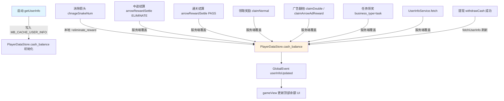
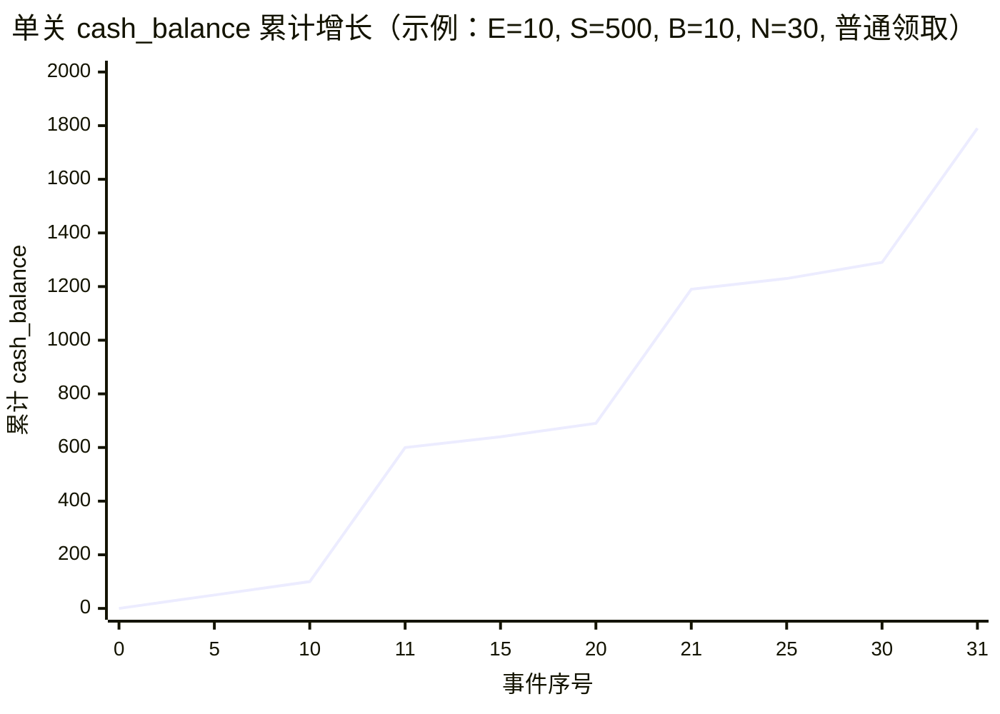
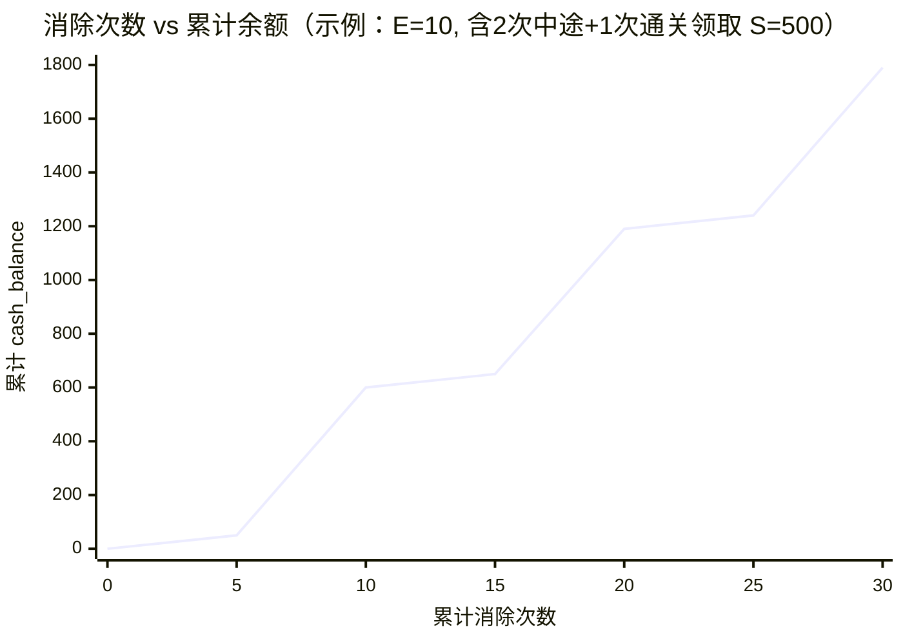
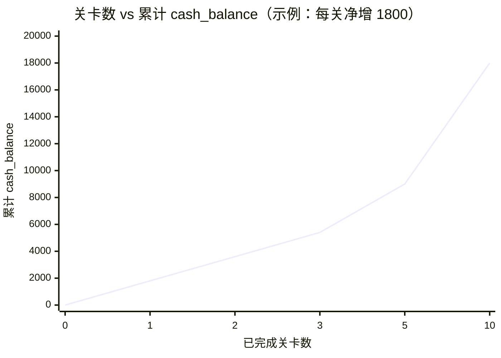

# MB_CACHE_USER_INFO.cash_balance 增长分析

> 分析范围：`assets/scripts/third` 及相关备份/解密代码  
> 分析日期：2026-10-17

---

## 一、localStorage 存储机制

### 1.1 缓存 Key

| Key | 写入时机 | 说明 |
|-----|---------|------|
| `MB_CACHE_USER_INFO` | 启动流程 `getUserInfo` 成功时 | 完整用户信息 JSON，含 `cash_balance` |
| `MB_CACHE_GAME_CONFIG` | `getGameConfig` 成功时 | 含 `max_cash_reward` 上限配置 |

写入代码位于 `LoadingProjectAdaptersBridge.ts`：

```typescript
const cacheKeys = {
    USER_INFO: "MB_CACHE_USER_INFO"
};
// getUserInfo 成功回调：
PlayerDataStore.init(res.data);
setCache(cacheKeys.USER_INFO, res.data);  // cc.sys.localStorage.setItem(key, JSON.stringify(value))
```

网络失败时读取缓存兜底：

```typescript
const cached = getCache(cacheKeys.USER_INFO);
if (cached) {
    PlayerDataStore.init(cached);
}
```

### 1.2 重要结论：运行时 localStorage **不会**随游戏内增钱而更新

全项目检索结果：`MB_CACHE_USER_INFO` **仅在启动 `getUserInfo` 成功时写入一次**，游戏过程中所有 `cash_balance` 变更只更新内存中的 `PlayerDataStore.cash_balance` 和 UI，**不会回写 localStorage**。

因此：

- **localStorage 中的 `cash_balance`** = 上次成功拉取用户信息时的快照（或离线缓存）
- **内存中的 `PlayerDataStore.cash_balance`** = 当前会话实时余额（消除、结算、领奖后更新）
- 过关后 `_refreshUserInfoAfterLevelPass()` 会调用 `UserInfoService.fetch()` 重新拉服务端数据，但同样**不写回** `MB_CACHE_USER_INFO`

---

## 二、cash_balance 变更路径总览



---

## 三、每次增加的数值范围

客户端对奖励数值的处理统一为：**非负整数**（`Math.max(0, Math.floor(amount))`）。

实际金额由**服务端下发**，客户端无硬编码具体数值；以下为各来源的**代码约束**与**逻辑范围**。

### 3.1 消除箭头小额奖励（客户端本地累加）

| 属性 | 说明 |
|------|------|
| **来源字段** | `PlayerDataStore.arrow_level.eliminate_reward`（来自 `ArrowLevelConfig` 接口 `xKmD9w/QrLv7n`） |
| **触发条件** | 每消除 1 支箭头（`chnageSnakeNum`），且 `eliminate_reward > 0` |
| **增加量** | 固定 `eliminate_reward`（整数，≥ 0；为 0 时不增加） |
| **代码位置** | `gameView.ts` → `chnageSnakeNum` |

```typescript
const eliminateReward = PlayerDataStore.arrow_level.eliminate_reward || 0;
if (eliminateReward > 0 && this.data_topBalanceMock) {
    const newBalance = (self.data_topBalanceMock.cash_balance || 0) + eliminateReward;
    PlayerDataStore.cash_balance = newBalance;
}
```

**范围**：`[0, +∞)`，具体值由服务端按关卡配置；客户端无上限校验。  
**注意**：此为**客户端乐观更新**，最终以服务端结算/领奖接口返回的 `cash_balance` 为准。

---

### 3.2 中途大额结算（消除阈值触发）

| 属性 | 说明 |
|------|------|
| **接口** | `ehwqDl/tMvhRC`（`ArrowRewardSettle`，`settle_type=ELIMINATE`） |
| **触发条件** | 累计消除数 `_eliminateCounter >= big_reward_trigger`，且剩余箭头 `> tail_clearance`，且未通关 |
| **增加量** | 服务端返回新 `cash_balance`（绝对值覆盖，非增量字段）；展示用 `switch_reward` |
| **代码位置** | `gameView.ts` → `_settleArrowReward(false, ...)` |

**单次增量（推算）**：

```
Δ = res.data.cash_balance - 变更前 cash_balance
```

奖励展示字段优先级（`ArrowRewardService.extractRewardAmount`）：

1. `cash_reward`
2. `reward_amount`
3. `ad_reward_amount`
4. `double_reward`
5. `switch_reward`
6. `task_reward`
7. `reward`
8. 兜底：`cash_balance_delta`（新余额 - 旧余额，仅当 delta ≥ 0）

**范围**：`[0, max_cash_reward]`（`max_cash_reward` 来自 `MB_CACHE_GAME_CONFIG`，客户端读取但未强制校验）

---

### 3.3 通关结算

| 属性 | 说明 |
|------|------|
| **接口** | `ehwqDl/tMvhRC`（`settle_type=PASS`，`level_passed=1`） |
| **触发条件** | 所有箭头消除完毕（`checkWin`，`num_current_snake <= 0`） |
| **增加量** | 服务端返回 `cash_balance` 绝对值；弹窗展示 `switch_reward` / `double_reward` |
| **后续** | 弹窗 `arrowSettleRewardView` 中用户点击 Claim / Claim×2 再次调用领奖接口 |

---

### 3.4 领取奖励（普通 / 强制广告 / 翻倍）

| 场景 | 接口 | 触发条件 |
|------|------|---------|
| 普通领取 | `ehwqDl/CCDFGN`（`claimArrowReward`） | 结算弹窗点 Claim；或 `showForceVideo=false` |
| 强制广告后领取 | 先播广告 → `vNZlOY/KWcPza`（`claimArrowAdReward`） | `showForceVideo=true` |
| 翻倍领取 | 播广告 → `vNZlOY/KWcPza` | 结算弹窗点 Claim×2（`claimDouble`） |
| 任务普通领奖 | `claimArrowReward`，`business_type=task` | 任务弹窗普通领取 |
| 任务翻倍领奖 | `claimDouble`，`business_type=task` | 任务弹窗看广告翻倍 |

**增加量**：接口返回的 `cash_balance` 覆盖内存值；展示增量取自上述 8 个奖励字段之一。

**翻倍关系（UI 层）**：

- 普通领取基准：`switch_reward`（`levelSwitchRewardAmount`）
- 翻倍展示：`double_reward`，若缺失则回退为 `switch_reward`

---

### 3.5 任务领奖

| 属性 | 说明 |
|------|------|
| **触发** | `arrowTaskPopupView.requestTaskReward` |
| **增加量** | 服务端 `cash_balance`；展示字段 `task_reward` / `switch_reward` |
| **同步** | 通过 `userInfoUpdated` 事件更新 UI |

---

### 3.6 用户信息刷新（非典型“增加”，可能增也可能减）

| 属性 | 说明 |
|------|------|
| **触发** | 过关后 `_refreshUserInfoAfterLevelPass`、提现成功后 `fetchUserInfoByService` |
| **接口** | `YZCUIm/MgQDzj`（`UserInfo`） |
| **效果** | 用服务端最新 `cash_balance` 覆盖内存（提现后通常会**减少**） |

---

### 3.7 数值范围汇总表

| 来源 | 增量类型 | 客户端已知范围 | 实际上限 |
|------|---------|---------------|---------|
| 消除箭头 | 固定 +E | E = `eliminate_reward` ≥ 0 | 服务端关卡配置 |
| 中途结算 | 服务端绝对值 | Δ ≥ 0（delta 只取非负） | `max_cash_reward`（配置项，未强制） |
| 通关结算 | 服务端绝对值 | 同上 | 同上 |
| 普通领取 | 服务端绝对值 | 通常 ≈ `switch_reward` | 同上 |
| 广告翻倍 | 服务端绝对值 | 通常 ≈ `double_reward` ≥ `switch_reward` | 同上 |
| 任务领奖 | 服务端绝对值 | `task_reward` | 同上 |
| 提现 | 服务端绝对值 | 减少余额 | 服务端规则 |

符号说明：

- **E** = `eliminate_reward`（每箭消除奖励）
- **S** = `switch_reward`（普通领取/结算展示金额）
- **D** = `double_reward`（翻倍领取金额，通常 D ≥ S）
- **B** = `big_reward_trigger`（触发中途结算的消除次数阈值）
- **T** = `tail_clearance`（剩余箭头 ≤ T 时跳过中途结算，默认 5）
- **N** = `arrow_count`（关卡箭头总数）

---

## 四、每次增加的条件详解

### 4.1 消除小额奖励

```
条件：eliminate_reward > 0
      AND 调用 chnageSnakeNum（每消除 1 箭）
动作：cash_balance += eliminate_reward（仅内存 + UI）
```

### 4.2 中途大额结算

```
条件：_eliminateCounter >= big_reward_trigger（B > 0）
  AND num_current_snake > 0（未通关）
  AND remainSnake > tail_clearance
动作：暂停游戏 → arrowRewardSettle(ELIMINATE) → 弹 arrowSettleRewardView
      → 用户 Claim / Claim×2 → cash_balance 由服务端更新
```

### 4.3 通关结算 + 领取

```
条件：num_current_snake <= 0
动作：arrowRewardSettle(PASS) → 弹结算窗 → 用户领取 → claimNormal / claimDouble
```

### 4.4 任务领奖

```
条件：任务完成且可领取
动作：ArrowRewardService.claimNormal / claimDouble（business_type=task）
```

### 4.5 强制广告领取

```
条件：settleData.show_force_video = true
动作：claimNormal({ showForceVideo: true }) → 播广告 → claimArrowAdReward
      广告失败则降级为普通 claimArrowReward
```

---

## 五、cash_balance 增长曲线

以下曲线基于**典型关卡参数**做示例推演（具体数值需以服务端 `ArrowLevelConfig` / 结算接口实际返回为准）。

### 5.1 示例参数（假设）

| 参数 | 假设值 | 含义 |
|------|--------|------|
| E | 10 | 每箭消除 +10 |
| S | 500 | 普通领取 +500 |
| D | 1000 | 翻倍领取 +1000 |
| B | 10 | 每消除 10 箭触发中途结算 |
| T | 5 | 剩余 ≤5 箭不再中途结算 |
| N | 30 | 关卡共 30 箭 |

### 5.2 单关内：事件次数 vs 累计 cash_balance

假设初始余额 0，普通领取（每次 +S），中途结算次数 = `floor((N-T)/B)` = `floor(25/10)` = 2 次，通关再领 1 次。

| 事件序号 | 事件类型 | 本次增量 | 累计余额 |
|---------|---------|---------|---------|
| 1~10 | 消除×10 | +10×10=100 | 100 |
| 11 | 中途结算+领取 | +500 | 600 |
| 12~20 | 消除×9 | +90 | 690 |
| 21 | 中途结算+领取 | +500 | 1190 |
| 22~30 | 消除×10 | +100 | 1290 |
| 31 | 通关结算+领取 | +500 | **1790** |

若全程选翻倍领取（+D=1000），累计约为：**100 + 1000 + 90 + 1000 + 100 + 1000 = 3290**



### 5.3 单关内：消除次数 vs 累计余额（含本地小额累加）

消除阶段余额近似线性增长（斜率 = E）；结算/领取处出现**阶跃**。



> 注：第 10、20 次消除后触发结算弹窗，用户点击领取后余额阶跃 +500；第 30 次消除通关后再 +500。

### 5.4 多关累计：关卡数 vs 总 cash_balance

假设每关参数相同（N=30, E=10, S=500），每关 2 次中途 + 1 次通关，均普通领取：

```
每关净增 ≈ N×E + 3×S = 30×10 + 3×500 = 300 + 1500 = 1800
```

| 关卡数 | 累计 cash_balance |
|--------|------------------|
| 0 | 0 |
| 1 | 1800 |
| 2 | 3600 |
| 3 | 5400 |
| 5 | 9000 |
| 10 | 18000 |



### 5.5 增长公式（通用）

**单关理论净增（普通领取）**：

```
Δ_level = N × E + M × S + S_pass

其中：
  M = 中途结算次数 ≈ floor((N - T) / B)  （当 B > 0 且 N > T）
  S_pass = 通关领取（通常 ≈ S）
```

**单关理论净增（全程翻倍）**：

```
Δ_level_double = N × E + M × D + D_pass
```

**多关累计**：

```
Total(L) = cash_balance_0 + Σ(i=1..L) Δ_level_i
```

若各关参数相同：`Total(L) ≈ cash_balance_0 + L × Δ_level`

---

## 六、奖励字段解析优先级

`ArrowRewardService.extractRewardAmount` 按以下顺序取增量：

```
cash_reward → reward_amount → ad_reward_amount → double_reward
→ switch_reward → task_reward → reward → cash_balance_delta
```

`arrowSettleRewardView.resolveClaimRewardAmount` 额外包含 `claim_reward`。

所有解析结果：`Math.max(0, Math.floor(value))`，即**非负整数**。

---

## 七、关键代码索引

| 文件 | 职责 |
|------|------|
| `LoadingProjectAdaptersBridge.ts` | `MB_CACHE_USER_INFO` 读写 |
| `PlayerDataStore.ts` | 内存 `cash_balance` 存储 |
| `gameView.ts` | 消除本地累加、结算触发 |
| `ArrowRewardService.ts` | 领奖接口、奖励解析 |
| `arrowSettleRewardView.ts` | 结算弹窗 Claim / Claim×2 |
| `arrowTaskPopupView.ts` | 任务领奖 |
| `UserInfoService.ts` | 拉取用户信息刷新余额 |
| `GameConfigStore.ts` | `max_cash_reward` 配置 |
| `BusinessRequestDescriptors.ts` | 接口 URI 映射 |

---

## 八、分析结论

1. **`MB_CACHE_USER_INFO.cash_balance` 仅在启动 `getUserInfo` 成功时写入 localStorage**，游戏内增钱不会同步到该缓存键。
2. **增加来源共 5 类**：消除小额（本地）、中途结算、通关结算、领奖（含广告翻倍）、任务领奖。
3. **数值范围**：客户端保证非负整数；具体金额由服务端按关卡/用户状态动态下发；`max_cash_reward` 为配置上界参考。
4. **消除奖励**为唯一客户端自行 `+` 的路径，增量固定为 `eliminate_reward`；其余均为服务端返回 `cash_balance` 绝对值覆盖。
5. **增长曲线**呈“线性小额累加 + 阶跃式大额领取”形态；中途结算次数由 `big_reward_trigger` 与 `tail_clearance` 决定。
6. **提现**会通过 `UserInfo` 刷新使 `cash_balance` 减少，但同样不写回 `MB_CACHE_USER_INFO`。

---

## 九、如何获取真实数值

客户端无本地 JSON 配置具体奖励金额，需通过以下方式获取实际范围：

1. 抓包 `xKmD9w/QrLv7n`（`ArrowLevelConfig`）→ 读取 `eliminate_reward`、`big_reward_trigger`
2. 抓包 `ehwqDl/tMvhRC`（`ArrowRewardSettle`）→ 读取 `switch_reward`、`cash_balance`
3. 抓包 `ehwqDl/CCDFGN` / `vNZlOY/KWcPza` → 读取领奖后 `cash_balance`
4. 读取 `MB_CACHE_GAME_CONFIG` 中 `max_cash_reward` 作为单次奖励上界参考
