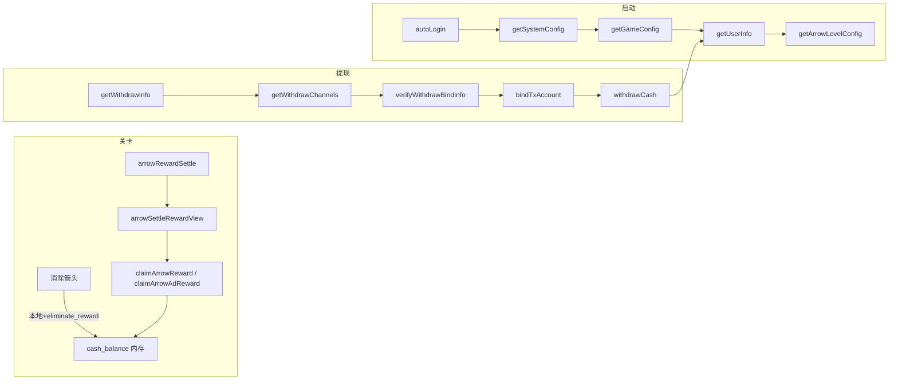

# CashArrows 外部接口说明

> 分析范围：`assets/scripts/third`（`LoadingHttpService`、`MiddleNetwork`、`HotUpdateManager` 等）  
> 整理日期：2026-10-19

---

## 一、通用约定

### 1.1 响应结构

绝大多数业务接口返回统一 JSON 信封：

| 字段 | 类型 | 含义 |
|------|------|------|
| `code` | number | 业务状态码；`1` 通常表示成功，`-1` / `-1000` 表示失败，`-777` 触发客户端强制重试弹窗 |
| `message` | string | 错误或提示文案，失败时用于 Toast / 日志 |
| `data` | object | 业务数据体；无数据时可能为 `null` 或省略 |

客户端读取返回值时，一般先判断 `code`，再使用 `data` 中的字段更新内存状态（`PlayerDataStore`、`UserData`、`GameConfigStore` 等）并刷新 UI。

### 1.2 请求方式

| 类型 | 基址 | 说明 |
|------|------|------|
| 业务接口 | `https://hxjxd.casharrows.com/` + URI | 经 `LoadingHttpService.request()`，POST，`Content-Type: text/plain`，body 加密 |
| SDK 提现接口 | `https://hxjxd.casharrows.com/vunuar/` + URI | 经 `LoadingHttpService.sdkRequest()`，独立签名 query |
| 中台接口 | `MiddleProjectAdapterConfig` 配置的各 URL | 经 `MiddleNetwork.request()` |
| 热更新 | `SystemDataStore.get_version_url()` | 经 `HotUpdateManager.getGrayVersion()` |

### 1.3 日志函数名对照

接入 `ApiRequestLogger` 后，日志第一个字段 `functionName` 即为下表「客户端方法」列。

---

## 二、启动 / 登录类接口

### 2.1 autoLogin — 自动登录

| 项 | 值 |
|----|-----|
| 客户端方法 | `LoadingHttpService.autoLogin` |
| URI | `mOIrra/GwJUnl` |
| 请求参数 | 无（`null`） |
| 调用时机 | 启动流程第一步（`LoadingProjectAdaptersBridge.runBaseFlow`） |

**返回值 `data` 字段：**

| 字段 | 含义 | 客户端用途 |
|------|------|-----------|
| `yid` | 用户会话标识 | 存在则视为自动登录成功，写入 `PlayerDataStore.initUserId()` 并缓存 `MB_CACHE_LOGIN_USER_ID`；不存在则降级游客登录 |
| `user_id` | 用户 ID | 同步到 `ClientDataStore.user_id` |
| `user_name` | 用户名 | 写入 `PlayerDataStore.user_name` |

---

### 2.2 touristsLogin — 游客登录

| 项 | 值 |
|----|-----|
| 客户端方法 | `LoadingHttpService.touristsLogin` |
| URI | `mOIrra/VfVrta` |
| 请求参数 | 无 |
| 调用时机 | `autoLogin` 未拿到 `yid` 时 |

**返回值 `data` 字段：** 同 `autoLogin`（`yid`、`user_id`、`user_name`），成功后继续拉系统配置。

---

### 2.3 getSystemConfig — 系统配置

| 项 | 值 |
|----|-----|
| 客户端方法 | `LoadingHttpService.getSystemConfig` |
| URI | `AfBJn/config` |
| 请求参数 | 无 |

**返回值 `data` 字段：**

| 字段 | 含义 | 客户端用途 |
|------|------|-----------|
| `is_encrypt` | 是否加密通信 | 写入 `SystemDataStore.encrypt`，控制后续请求是否加密 body |
| `new_user` / `is_new` | 是否新用户 | 写入 `SystemDataStore.new_user`，用于新用户逻辑判断 |

缓存键：`MB_CACHE_SYSTEM_CONFIG`。

---

### 2.4 getGameConfig — 游戏全局配置

| 项 | 值 |
|----|-----|
| 客户端方法 | `LoadingHttpService.getGameConfig` |
| URI | `AfBJn/getGameConfig` |
| 请求参数 | 无 |

**返回值 `data` 字段：**

| 字段 | 含义 | 客户端用途 |
|------|------|-----------|
| `game_level_phase_cfg` | 关卡阶段配置 | 存入 `GameConfigStore.game_level_phase_cfg` |
| `difficulty_max` | 难度上限 | 存入 `GameConfigStore.difficulty_max` |
| `difficulty_min` | 难度下限 | 存入 `GameConfigStore.difficulty_min` |
| `max_cash_reward` | 单次现金奖励上界参考 | 存入 `GameConfigStore.max_cash_reward`（客户端未强制校验） |
| `props_rate_conf` | 道具概率配置 | 存入 `GameConfigStore.props_rate_conf` |
| `app_review_enabled` | 是否开启应用内评价 | 存入 `GameConfigStore.app_review_enabled` 及 localStorage `MB_APP_REVIEW_ENABLED` |

缓存键：`MB_CACHE_GAME_CONFIG`。

---

### 2.5 getUserInfo — 用户信息

| 项 | 值 |
|----|-----|
| 客户端方法 | `LoadingHttpService.getUserInfo` |
| URI | `YZCUIm/MgQDzj` |
| 请求参数 | 无 |
| 调用时机 | 启动流程、过关后刷新、提现成功后刷新 |

**返回值 `data` 字段（核心）：**

| 字段 | 含义 | 客户端用途 |
|------|------|-----------|
| `cash_balance` | 现金余额（绝对值） | 覆盖 `PlayerDataStore.cash_balance`、顶部余额 UI |
| `fund_balance` | 基金余额 | 写入 `PlayerDataStore.fund_balance` |
| `bubble_balance` | 气泡/红包余额 | 写入 `PlayerDataStore.bubble_balance` |
| `user_level` | 用户等级 | 写入 `PlayerDataStore.user_level`、`UserData.user_level` |
| `hint_prop_count` | 提示道具数量 | 同步 `UserData.hint_prop_count` / `num_tipscards` |
| `guideline_prop_count` | 辅助线道具数量 | 同步 `UserData.guideline_prop_count` |
| `task_point_num` | 日常任务可领数量（红点） | 写入 `PlayerDataStore.task_point_num`，驱动任务红点 |
| `ltv_task_point_num` | 生涯任务可领数量 | 写入 `PlayerDataStore.ltv_task_point_num` |
| `levels_passed_count` | 累计通关数 | 写入 `PlayerDataStore.levels_passed_count` |
| `current_arrow_level_id` | 当前箭头关卡 ID | 启动时用于请求关卡配置 |
| `tx_bind_info` | 已绑定的提现账户列表 | 提现流程匹配渠道 |
| `is_tourists` | 是否游客 | 写入 `PlayerDataStore.is_tourists` |
| `conf.parameter_conf` | 参数配置 | 写入 `PlayerDataStore.conf` |
| `conf.cash_extract_conf` | 提现条件配置 | `UserInfoService` 解析为 `extract_money`、`bubble_status`、`levels_passed_limit` 等提现 UI 条件 |

缓存键：`MB_CACHE_USER_INFO`（仅启动成功时写入一次，游戏内增钱不回写）。

---

### 2.6 syncFirebaseToken — Firebase Token 同步

| 项 | 值 |
|----|-----|
| 客户端方法 | `LoadingHttpService.syncFirebaseToken` |
| URI | `YZCUIm/KJvhdv` |
| 请求参数 | `{ firebase_token: string }` |

**用途：** 原生端推送 Token 上报，客户端仅转发，不解析 `data` 业务字段。

---

### 2.7 getGrayVersion — 热更新灰度版本（HotUpdate）

| 项 | 值 |
|----|-----|
| 客户端方法 | `HotUpdateManager.getGrayVersion` |
| URI | `lpzvzk`（拼接在 server 域名后） |
| 请求参数 | 加密后的热更请求 body（由 `buildHotUpdateBody` 生成） |

**返回值字段：**

| 字段 | 含义 | 客户端用途 |
|------|------|-----------|
| `code` | `1` 表示有灰度包 | 决定是否下载远程 manifest |
| `data.url` | 灰度版本 manifest 下载地址 | `jsb.Downloader` 下载并触发热更新比对 |

---

## 三、箭头关卡 / 奖励类接口

### 3.1 getArrowLevelConfig — 关卡配置

| 项 | 值 |
|----|-----|
| 客户端方法 | `LoadingHttpService.getArrowLevelConfig` |
| URI | `xKmD9w/QrLv7n` |
| 请求参数 | `{ arrow_level_id: number }` |

**返回值 `data` 字段：**

| 字段 | 含义 | 客户端用途 |
|------|------|-----------|
| `arrow_level` | 关卡配置对象 | 调用 `PlayerDataStore.updateArrowLevel()` |
| `arrow_level.arrow_level_id` | 关卡 ID | 标识当前关卡 |
| `arrow_level.level_index` | 关卡文件索引 | 加载 `level_{index}.json` 地图 |
| `arrow_level.arrow_count` | 箭头总数 | 初始化关卡箭头数量 |
| `arrow_level.time_limit` | 时间限制（秒） | 倒计时逻辑 |
| `arrow_level.big_reward_trigger` | 中途大额结算触发阈值（消除次数） | 控制 `_settleArrowReward(ELIMINATE)` 触发 |
| `arrow_level.tail_clearance` | 尾部豁免阈值（剩余箭头数） | 剩余 ≤ 该值时不再触发中途结算，默认 5 |
| `arrow_level.eliminate_reward` | 每消除一支箭的本地小额奖励 | `gameView.chnageSnakeNum` 乐观累加 `cash_balance` |
| `arrow_level.life_count` | 生命/错误次数上限 | 失败判定 |
| `arrow_level.show_countdown` | 是否显示倒计时 | UI 控制 |

---

### 3.2 arrowRewardSettle — 关卡结算

| 项 | 值 |
|----|-----|
| 客户端方法 | `LoadingHttpService.arrowRewardSettle` |
| URI | `ehwqDl/tMvhRC` |

**请求参数（`gameView._settleArrowReward` 组装）：**

| 字段 | 含义 |
|------|------|
| `settle_type` | `"PASS"` 通关结算 / `"ELIMINATE"` 中途大额结算 / `"FAIL"` 失败上报 |
| `level_passed` | `1` 通关 / `0` 未通关 |
| `eliminate_count` | 累计消除箭头数 |
| `arrow_level_id` | 当前关卡 ID |
| `level_index` | 关卡索引 |
| `arrow_count` | 关卡箭头总数 |
| `mistake_count` / `life_used` | 失误次数 |
| `retry_count` | 重开次数 |
| `hint_used` | 提示道具使用次数 |
| `revive_count` | 复活次数 |
| `duration_sec` | 本局耗时（秒） |
| `clean_win` | 是否零失误零复活通关（`1`/`0`） |
| `level_fail` | 失败标记（失败上报时） |

**返回值 `data` 字段：**

| 字段 | 含义 | 客户端用途 |
|------|------|-----------|
| `cash_balance` | 服务端最新现金余额（绝对值） | 覆盖 `PlayerDataStore.cash_balance` 并刷新顶部 UI |
| `switch_reward` | 普通领取展示金额 | 结算弹窗 `arrowSettleRewardView` 展示 Claim 金额 |
| `double_reward` | 看广告翻倍领取展示金额 | 结算弹窗 Claim×2 展示；缺失时回退 `switch_reward` |
| `show_force_video` | 是否强制看广告才能领取 | 为 `true` 时 `claimNormal({ showForceVideo: true })` 先播广告 |
| `is_new` | 是否新用户奖励样式 | 控制结算弹窗新用户 UI |
| `arrow_level` | 下一关配置（通关时） | 通关成功后 `PlayerDataStore.updateArrowLevel()`，推进下一关 |

**流程：** 结算成功 → 弹出 `arrowSettleRewardView` → 用户点击 Claim / Claim×2 → 调用领奖接口（见 3.3、3.4）。

---

### 3.3 claimArrowReward — 普通领取奖励

| 项 | 值 |
|----|-----|
| 客户端方法 | `LoadingHttpService.claimArrowReward` |
| URI | `ehwqDl/CCDFGN` |
| 封装 | `ArrowRewardService.claimNormal` |

**请求参数：**

| 字段 | 含义 |
|------|------|
| `business_type` | `"arrow"` 关卡奖励 / `"task"` 任务奖励 |
| `task_id` | 任务 ID（`business_type=task` 时） |
| `task_type` | 任务类型，生涯任务为 `"ltv"` |

**返回值 `data` 字段：**

| 字段 | 含义 | 客户端用途 |
|------|------|-----------|
| `cash_balance` | 领取后余额（绝对值） | 覆盖 `PlayerDataStore.cash_balance` |
| `switch_reward` | 本次领取金额 | 奖励展示、`extractRewardAmount` 解析 |
| `double_reward` | 翻倍金额（若有） | 翻倍场景展示 |
| `cash_reward` / `reward_amount` / `reward` | 其他奖励金额字段 | `ArrowRewardService.extractRewardAmount` 按优先级解析 |
| `bubble_balance` | 气泡余额 | 同步用户数据 |
| `hint_prop_count` / `guideline_prop_count` | 道具数量 | 同步 `UserData` |
| `task_point_num` / `ltv_task_point_num` | 任务红点 | 更新任务可领数 |
| `user_level` / `sign_in` | 等级 / 签到 | 同步用户状态 |

解析成功后触发 `userInfoUpdated`、`arrowRewardClaimed` 事件。

---

### 3.4 claimArrowAdReward — 广告翻倍 / 广告领奖

| 项 | 值 |
|----|-----|
| 客户端方法 | `LoadingHttpService.claimArrowAdReward` |
| URI | `vNZlOY/KWcPza` |
| 封装 | `ArrowRewardService.claimDouble`、`claimNormal(showForceVideo)`、道具视频领奖 |

**请求参数：**

| 字段 | 含义 |
|------|------|
| `business_type` | `"arrow"` / `"task"` |
| `video_type` | 广告场景：`"big_red"` 大额红包 / `"task"` 任务 / `"hint_prop"` / `"guideline_prop"` 道具 |
| `task_id` | 任务或广告 task_id |
| `force_type` | 是否强制广告 `"true"` / `"false"` |
| `source` / `unitId` / `cpm` | 广告 SDK 回传的 CPM 数据 | 服务端广告统计 |

**返回值 `data` 字段：** 与 `claimArrowReward` 相同，由 `applyRewardResult` 统一处理。

**特殊用途：**
- 关卡 Claim×2 → 播广告后调用，期望 `double_reward` ≥ `switch_reward`
- 强制广告领取 → 广告成功后调用，失败则降级 `claimArrowReward`
- 道具视频 → 更新 `hint_prop_count` / `guideline_prop_count`

---

### 3.5 consumeArrowProp — 消耗道具

| 项 | 值 |
|----|-----|
| 客户端方法 | `LoadingHttpService.consumeArrowProp` |
| URI | `xKmD9w/pUsH3k` |
| 请求参数 | `{ prop_type: number }`（提示 / 辅助线类型枚举） |

**返回值 `data` 字段：**

| 字段 | 含义 | 客户端用途 |
|------|------|-----------|
| `hint_prop_count` | 提示道具剩余数 | 更新 `UserData` 并刷新提示按钮状态 |
| `guideline_prop_count` | 辅助线道具剩余数 | 更新 `UserData` 并刷新辅助按钮状态 |

---

## 四、任务类接口

### 4.1 getTaskInfo — 任务列表

| 项 | 值 |
|----|-----|
| 客户端方法 | `LoadingHttpService.getTaskInfo` |
| URI | `YZCUIm/UCNZBa` |
| 请求参数 | `{ task_type?: string }`；日常任务不传或传空，生涯任务传 `"ltv"` |

**返回值 `data` 字段：**

| 字段 | 含义 | 客户端用途 |
|------|------|-----------|
| `task_list` | 任务数组 | 渲染 `arrowTaskPopupView` 任务列表 |
| `task_point_num` | 日常可领任务数 | 红点：`PlayerDataStore.task_point_num` |
| `ltv_task_point_num` | 生涯可领任务数 | 红点：`PlayerDataStore.ltv_task_point_num` |

**`task_list[]` 单条任务字段：**

| 字段 | 含义 | 客户端用途 |
|------|------|-----------|
| `id` | 任务 ID | 领奖时传 `task_id` |
| `status` | `0` 未完成 / `1` 可领取 / `2` 已领取 | 控制按钮状态与排序 |
| `task_desc` | 任务描述 | UI 展示 |
| `task_type` | 任务类型（login/level/ad 等） | 解析为 UI 图标与文案 |
| `task_num` / `task_count` | 目标进度 | 进度条分母 |
| `finished_num` | 已完成进度 | 进度条分子 |
| `task_reward` / `reward` | 普通领取金额 | 弹窗「仅领取」展示 |
| `show_amount` / `show_reward` / `double_amount` | 广告翻倍展示金额 | 弹窗主金额、Claim×2 |
| `if_daily` | 是否日常任务 | 分组到 daily / career 页签 |

---

### 4.2 claimTaskReward — 任务普通领奖

| 项 | 值 |
|----|-----|
| 客户端方法 | `LoadingHttpService.claimTaskReward` |
| URI | `YZCUIm/PpAmkA`（`TaskOnlyReward`） |
| 请求参数 | `{ task_id, task_type? }` |

**返回值：** 同 `claimArrowReward`（`business_type=task`），更新余额与任务状态。

---

### 4.3 claimTaskAdReward — 任务广告翻倍领奖

| 项 | 值 |
|----|-----|
| 客户端方法 | `LoadingHttpService.claimTaskAdReward` |
| URI | `YZCUIm/PpAmkA`（`TaskShowReward`） |
| 请求参数 | `{ task_id, task_type?, ...广告 CPM 字段 }` |

**返回值：** 同 `claimArrowAdReward`，任务场景 `video_type="task"`。

---

## 五、提现类接口

### 5.1 getWithdrawInfo — 提现页信息

| 项 | 值 |
|----|-----|
| 客户端方法 | `LoadingHttpService.getWithdrawInfo` |
| URI | `LcmMRi/BYqawo` |
| 调用方 | `withMoodView.loadWithdrawInfo` |

**返回值 `data` 字段：**

| 字段 | 含义 | 客户端用途 |
|------|------|-----------|
| `cash_balance` | 当前余额 | 提现页余额展示 |
| `user_level` / `game_level` | 用户等级 | 提现档位条件展示 |
| `info[]` | 提现档位列表 | 渲染可选提现金额选项 |
| `info[].id` | 档位 ID | 提现时传 `tx_id` |
| `info[].money` | 档位金额 | UI 展示与余额差计算 |
| `info[].status` | 档位解锁状态 | `0` 余额不足 / `4` 可提现等，见 `checkWithdrawCondition` |

---

### 5.2 getWithdrawChannels — 提现渠道列表

| 项 | 值 |
|----|-----|
| 客户端方法 | `LoadingHttpService.getWithdrawChannels` |
| URI | `c_l`（SDK 域名） |
| 封装 | `sdkRequest` |

**返回值 `data` 字段：**

| 字段 | 含义 | 客户端用途 |
|------|------|-----------|
| `channel_list` / `channels` / `list` | 渠道数组 | 提取后展示绑定/选择 UI |
| 渠道项 `channel` | 主渠道标识 | 绑定、提现请求 |
| 渠道项 `sub_channel` | 子渠道 | 绑定匹配 |
| 渠道项字段配置 | 表单字段定义 | `cashArrowSetView` 动态表单 |

---

### 5.3 verifyWithdrawBindInfo — 校验绑定信息

| 项 | 值 |
|----|-----|
| 客户端方法 | `LoadingHttpService.verifyWithdrawBindInfo` |
| URI | `ck_i`（SDK 域名） |
| 请求参数 | `{ channel, sub_channel, info: object|string }` |

**返回值 `data` 字段：**

| 字段 | 含义 | 客户端用途 |
|------|------|-----------|
| `check_info` | 各字段校验结果 object / JSON 字符串 | 逐字段判断是否通过；失败字段展示 `fail_desc` |

---

### 5.4 bindTxAccount — 绑定提现账户

| 项 | 值 |
|----|-----|
| 客户端方法 | `LoadingHttpService.bindTxAccount` |
| URI | `LcmMRi/arHKkf` |
| 请求参数 | 渠道 + 账户信息（由 `buildBindRequestData` 组装） |

**返回值 `data` 字段：**

| 字段 | 含义 | 客户端用途 |
|------|------|-----------|
| 绑定结果 / 更新后的 `tx_bind_info` | 服务端确认的绑定信息 | `syncBindInfoToStore` 写入 `PlayerDataStore.tx_bind_info`，通过后继续提现 |

---

### 5.5 withdrawCash — 发起提现

| 项 | 值 |
|----|-----|
| 客户端方法 | `LoadingHttpService.withdrawCash` |
| URI | `LcmMRi/ZworCc` |
| 请求参数 | `{ tx_id, channel, sub_channel }` |

**返回值：**

| 字段 | 含义 | 客户端用途 |
|------|------|-----------|
| `code === 1` | 提现受理成功 | Toast 成功，关闭确认页，调用 `getUserInfo` 刷新余额（通常减少） |
| `message` | 失败原因 | Toast 展示 |

---

## 六、其他业务接口

### 6.1 getBarrageList — 提现弹幕

| 项 | 值 |
|----|-----|
| 客户端方法 | `LoadingHttpService.getBarrageList` |
| URI | `YZCUIm/PqyICJ` |

**返回值 `data` 字段：**

| 字段 | 含义 | 客户端用途 |
|------|------|-----------|
| `money_list[]` | 弹幕数据列表 | `BarrageDataService` 队列播放 |
| `money_list[].name` | 用户名 | 弹幕文案 |
| `money_list[].money` | 提现金额 | 格式化货币展示 |
| `money_list[].type` | 类型（如 `cash`） | 文案模板选择 |

---

## 七、中台接口（MiddleNetwork）

中台接口主要用于归因、埋点、广告配置，一般不直接驱动游戏核心玩法 UI。

| 客户端方法 | descriptorKey | 含义 | 典型返回值用途 |
|-----------|---------------|------|---------------|
| `getMiddleCountry` | `Regional` | 获取国家/地区 | 写入 `ClientDataStore.local_country`，决定语言与接口 `cy` 参数 |
| `getMiddleTFRegional` | `TFRegional` | TF 归因区域 | `is_self_match_tf` 等字段用于归因上报 |
| `getSDKEvent` | `event` | SDK 事件上报 | 服务端确认，客户端不解析业务 UI |
| `trackAdSdk` | `ADSDK` | 广告 SDK 埋点 | 批量上报广告事件 |
| `trackCoreData` | `COREDATA` | 核心数据上报 | 用户行为/设备核心指标 |
| `trackAppLog` | `APPLOG` | 应用日志上报 | 运行时日志批量上传 |
| `getPlatform` | `Platform` | 平台信息 | 中台初始化 |
| `submitWithdrawal` | `BindWithdrawal` | 中台提现校验 | 与中台提现风控联动 |
| `getAdConfig` | `AdConfig` | 广告配置 | `config.urls[].sst` 解密后作为广告 SDK 配置源 |

**中台响应特点：** 部分接口 `data` 为空时视为失败；`code === -1` 或 `-1000` 走失败回调。

---

## 八、奖励金额字段解析优先级

`ArrowRewardService.extractRewardAmount` 按以下顺序取「本次奖励展示/增量」：

```
cash_reward → reward_amount → ad_reward_amount → double_reward
→ switch_reward → task_reward → reward → cash_balance_delta
```

所有解析结果：`Math.max(0, Math.floor(value))`，即非负整数。

| 字段 | 典型场景 |
|------|---------|
| `switch_reward` | 关卡结算弹窗普通领取基准金额 |
| `double_reward` | 看广告翻倍领取金额 |
| `task_reward` | 任务普通领取金额 |
| `cash_balance` | 服务端权威余额，**绝对值覆盖**，非增量字段 |

---

## 九、接口调用关系简图



---

## 十、代码索引

| 文件 | 职责 |
|------|------|
| `BusinessRequestDescriptors.ts` | 业务 URI 与 requestKey 映射 |
| `LoadingHttpService.ts` | 业务 / SDK HTTP 封装 |
| `MiddleNetwork.ts` | 中台 HTTP 封装 |
| `LoadingProjectAdaptersBridge.ts` | 启动链路接口编排 |
| `PlayerDataStore.ts` | 用户信息内存存储 |
| `GameConfigStore.ts` | 游戏全局配置 |
| `ArrowRewardService.ts` | 领奖逻辑与奖励字段解析 |
| `gameView.ts` | 结算请求组装与余额更新 |
| `arrowSettleRewardView.ts` | 结算弹窗与奖励展示 |
| `arrowTaskPopupView.ts` | 任务列表与任务领奖 |
| `withMoodView.ts` | 提现页与提现流程 |
| `UserInfoService.ts` | 用户信息刷新与提现条件同步 |
| `ApiRequestLogger.ts` | 外部接口统一日志（含 functionName） |

---

## 十一、备注

1. 本文档字段含义来自客户端**实际读取与使用**的代码推断，服务端完整 schema 以抓包为准。
2. 未在当前工程中调用的 descriptor（如 `AdMake`、`StartGame` 等）未列入详细说明，URI 见 `BusinessRequestDescriptors.ts`。
3. 更详细的 `cash_balance` 变更路径与增长分析见同目录 [`cash_balance分析.md`](./cash_balance分析.md)。
